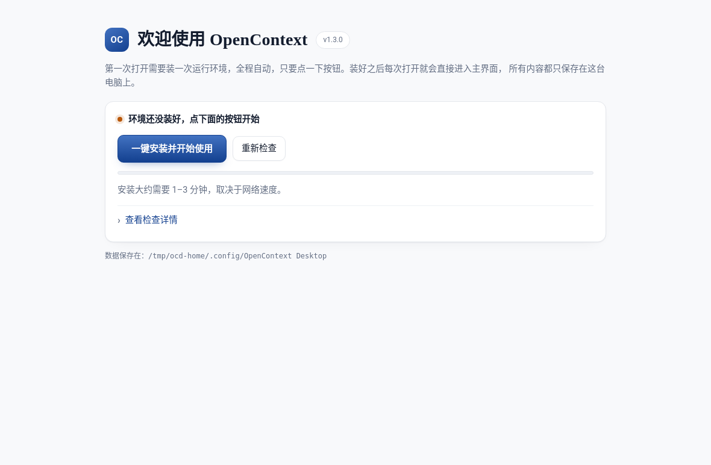
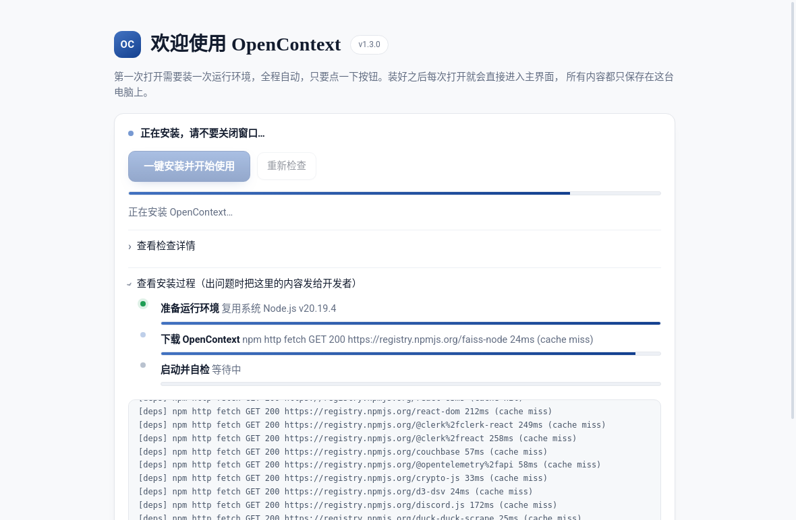
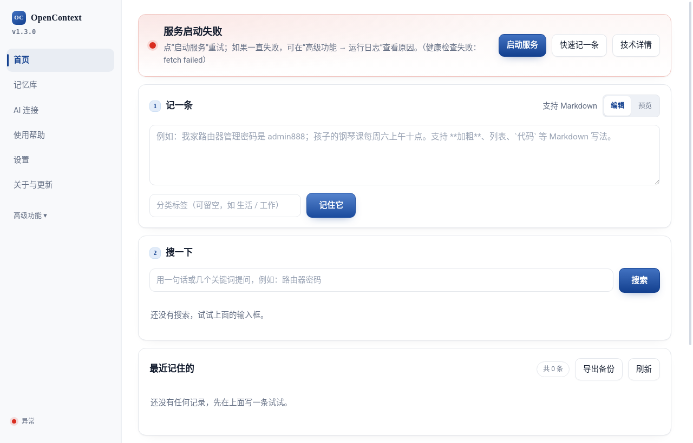
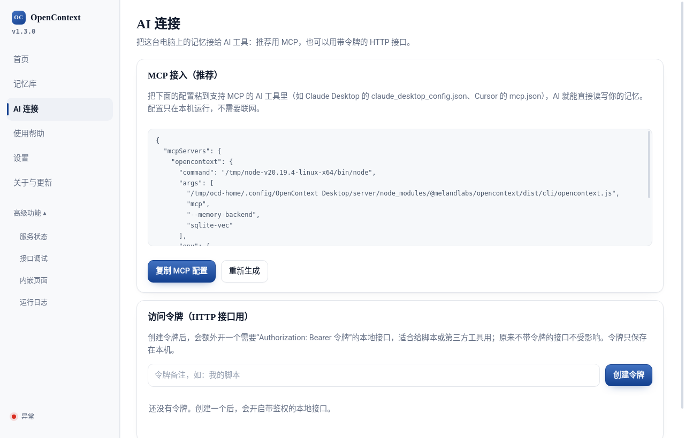
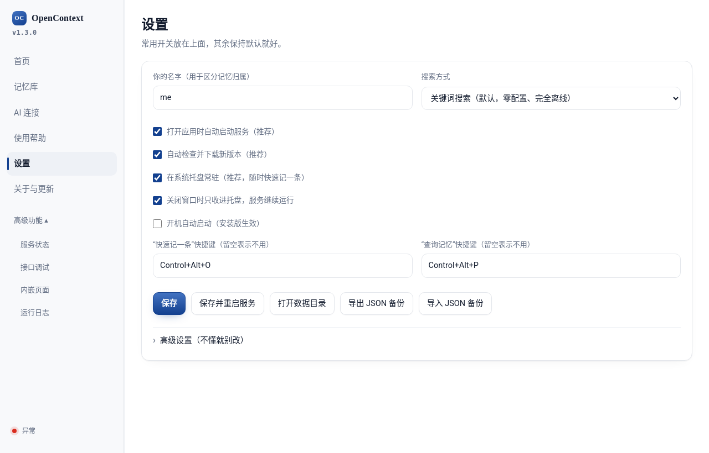
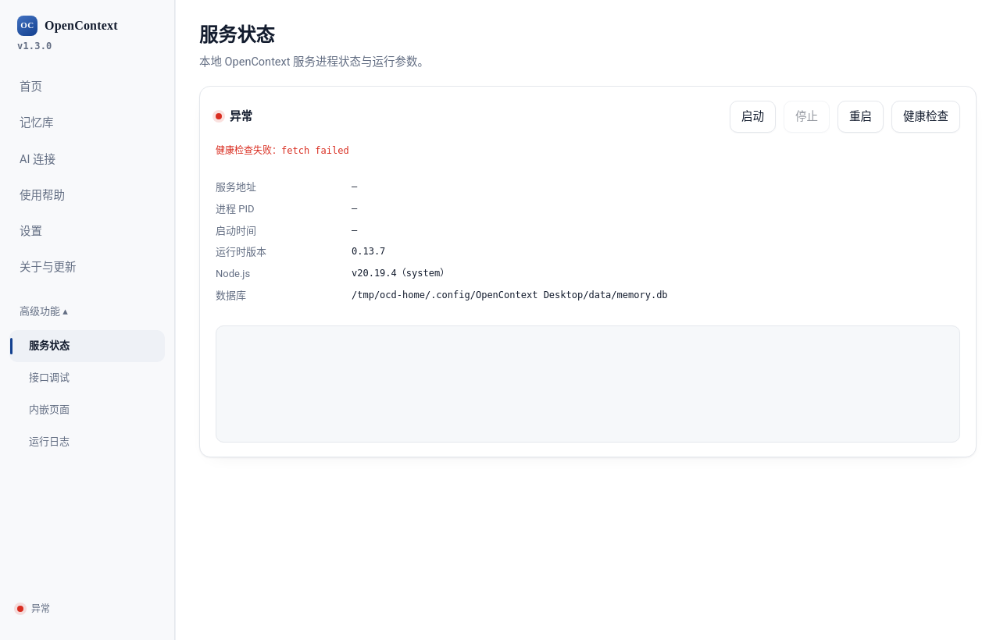

# OpenContext Desktop

**English** | [简体中文](README.zh-CN.md)

A one-click desktop client for **OpenContext**, a local memory store that runs entirely on your own computer. It is an Electron shell around the OpenContext agentic context runtime ([`@melandlabs/opencontext`](https://www.npmjs.com/package/@melandlabs/opencontext)). On first run it checks the environment, installs the runtime automatically and starts the local service. After that you can write, search and manage memories in a built-in control panel, and connect them to AI tools over MCP or a token-protected HTTP API. It also supports in-app updates. The UI is in Chinese.

## Features

- **First-run setup**: checks the platform (Linux / macOS / Windows, x64 / arm64), Node.js, npm, the npm registry and the port, then installs everything with one click. If the machine has no suitable Node.js (≥ 20), it downloads a managed Node.js LTS from `nodejs.org`. It then installs `@melandlabs/opencontext` and `@melandlabs/ai-rag` into the app data directory and runs a health check.
- **Local service management**: starts the OpenContext HTTP daemon on `127.0.0.1` (default port 7421, moves to the next free port if busy), auto-start, start / stop / restart, health check, service and desktop logs.
- **Memory home page**: write notes (with Markdown preview), keyword search, recent memories, JSON export.
- **Memory library**: stats, 14-day trend, tag filter, sort, paging, trash with restore / permanent delete, JSON import / export.
- **AI connection**:
  - **MCP**: generates a ready-to-paste MCP config (for Claude Desktop, Cursor, etc.) that runs `opencontext mcp` over stdio against the same local database.
  - **Access tokens**: a small proxy in the main process (default port 7431) requires `Authorization: Bearer <token>` and forwards to the daemon; tokens are created and revoked in the UI.
- **Tray and global hotkeys**: stays in the system tray; `Control+Alt+O` opens quick capture and `Control+Alt+P` opens quick search (configurable).
- **Search modes**: keyword (default, offline), smart search (local embedding model, ~90 MB download on first use), or a cloud model (needs your own API key environment variable).
- **Advanced tools**: service status, API console (`POST /v1/raw-messages`, `POST /v1/search`, `GET /v1/raw-messages/:id`), embedded web page and live logs.
- **Updates**: `electron-updater` against GitHub Releases (check, download, restart and install).

## Screenshots

These were captured on Linux by launching the real Electron app under Xvfb and driving it with Playwright. The first-run install really did download and install the runtime, but in this test environment the OpenContext daemon (`@melandlabs/opencontext` 0.13.7) crashed on start with `SIGSEGV`. So the control-panel screenshots show the real UI in the **"service not running"** state, without data.

| First run: environment check | First run: installing |
| --- | --- |
|  |  |
| **Home (service not running)** | **AI connection: MCP config & tokens** |
|  |  |
| **Settings** | **Service status** |
|  |  |

## Tech stack

- Electron 31 (plain HTML / CSS / JS renderer, `contextIsolation` + preload bridge)
- electron-builder 24 (AppImage, deb, NSIS, dmg, zip), electron-updater 6
- tar-fs and yauzl for unpacking the managed Node.js archive
- Runtime: `@melandlabs/opencontext` + `@melandlabs/ai-rag` (installed at first run, not bundled)

## Quick start

Requires Node.js 20 for development (the version used in CI).

```bash
git clone https://github.com/gatesenman/opencontext-desktop.git
cd opencontext-desktop
npm ci
npm start            # electron .
```

Package installers into `dist/`:

```bash
npm run dist         # current platform
npm run dist:linux   # AppImage + deb (x64)
npm run dist:win     # NSIS installer (x64)
npm run dist:mac     # dmg + zip (x64, arm64)
```

Pushing a `v*` tag runs `.github/workflows/release.yml`, which builds on Ubuntu, Windows and macOS and publishes to GitHub Releases.

## Project structure

```
src/
├── main/
│   ├── index.js          # app lifecycle, windows, IPC handlers
│   ├── preload.js        # window.opencontext bridge
│   ├── env-check.js      # platform / Node / npm / registry / port checks
│   ├── installer.js      # managed Node.js download + runtime npm install + health check
│   ├── toolchain.js      # resolve managed or system node + npm
│   ├── daemon.js         # spawn and supervise the OpenContext HTTP daemon
│   ├── memory.js         # save / search / browse / trash / import / export
│   ├── access.js         # MCP config + token-protected HTTP proxy
│   ├── quick-capture.js  quick-search.js  tray.js  updater.js
│   ├── config.js  paths.js  logger.js
│   └── scripts/local-store.js   # offline keyword search helper (unpacked from asar)
├── renderer/             # setup.html, dashboard.html, quick*.html + JS + styles.css
└── assets/tray.png
build/                    # icon.png, make-icon.py
electron-builder.yml
```

## Configuration

Settings are edited in the app (Settings page) and stored in `config.json` in the Electron user-data directory (for example `~/.config/OpenContext Desktop` on Linux). The same directory holds `node-runtime/`, `server/`, `data/memory.db` and `logs/`.

| Setting | Default |
| --- | --- |
| Listen address / port | `127.0.0.1` / `7421` |
| Token proxy port | `7431` |
| Memory backend | `sqlite-vec` (also `chroma`, `none`) |
| Embedding provider | `none` (keyword search) |
| Quick capture / quick search hotkeys | `Control+Alt+O` / `Control+Alt+P` |
| npm registry / Node.js mirror | npm default / `https://nodejs.org/dist` |

Environment variable: `OPENCONTEXT_NODE_PATH` makes the app try a specific Node.js binary before the system `node`.

## Known issues

- If the system Node.js is newer than the versions that `better-sqlite3` ships prebuilt binaries for (for example Node 24), the runtime install fails while compiling `better-sqlite3`. The app prefers a system Node ≥ 20 over downloading its own. Workaround: set `OPENCONTEXT_NODE_PATH` to a Node 20 binary (and put its npm first on `PATH`).

## Contributing

Issues and pull requests are welcome. Run `npm start` to test changes; there is no build step for the renderer.

## License

[Apache-2.0](LICENSE)
