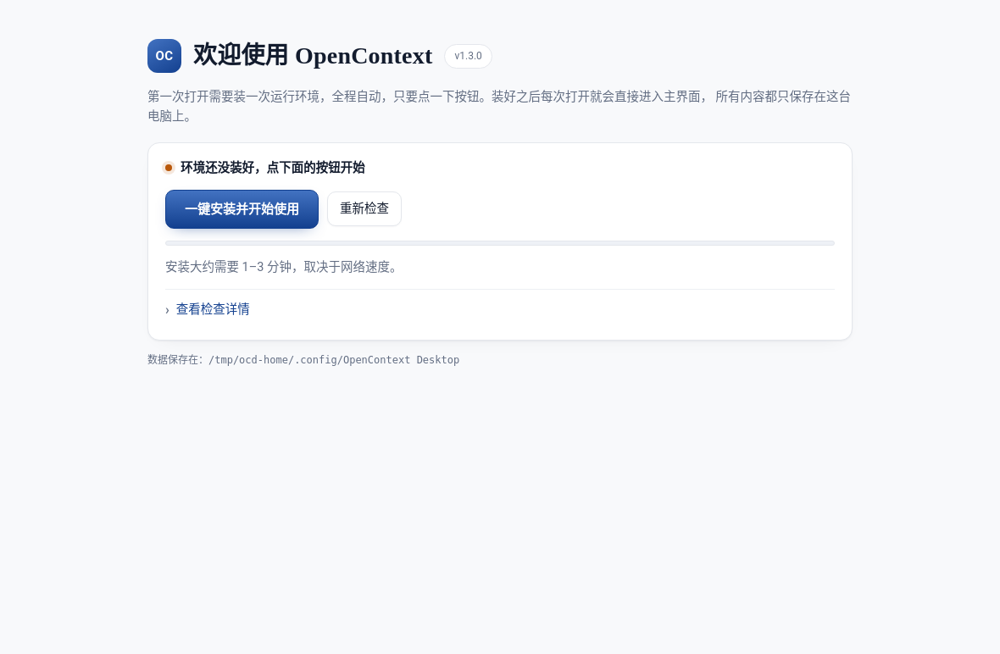
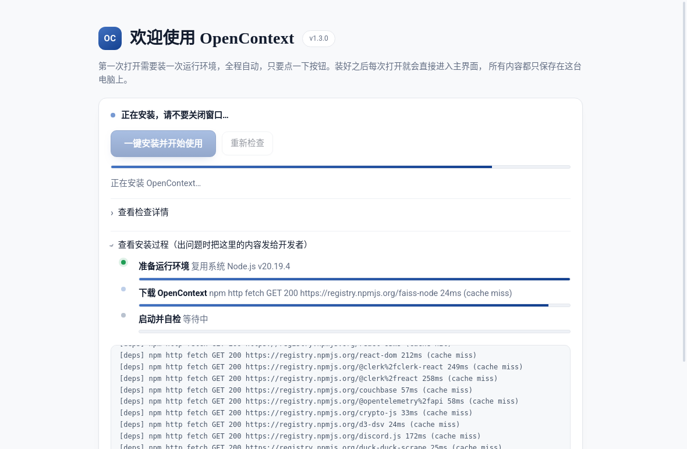
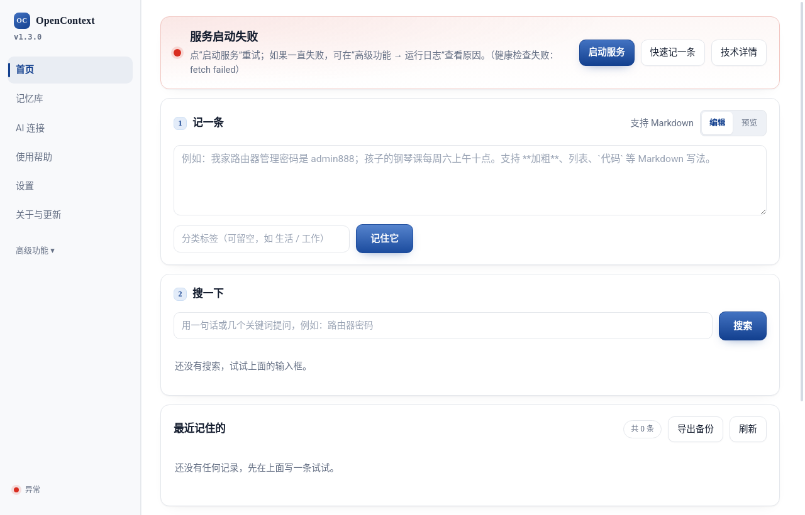
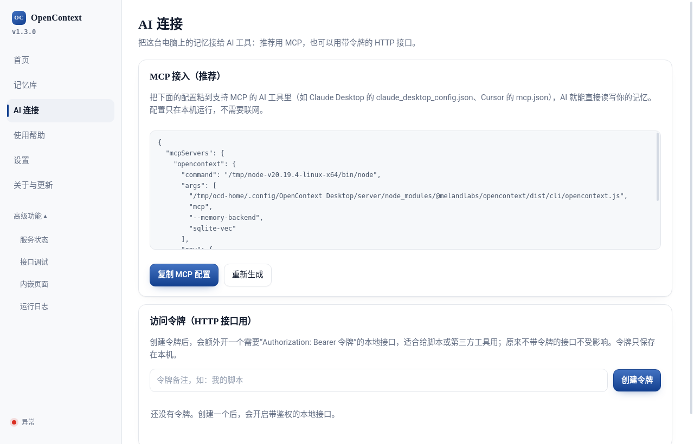
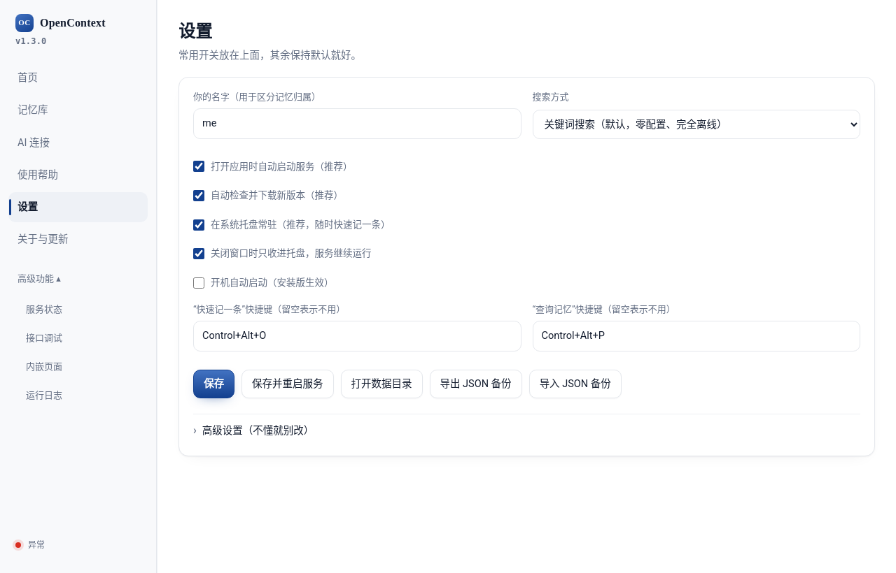
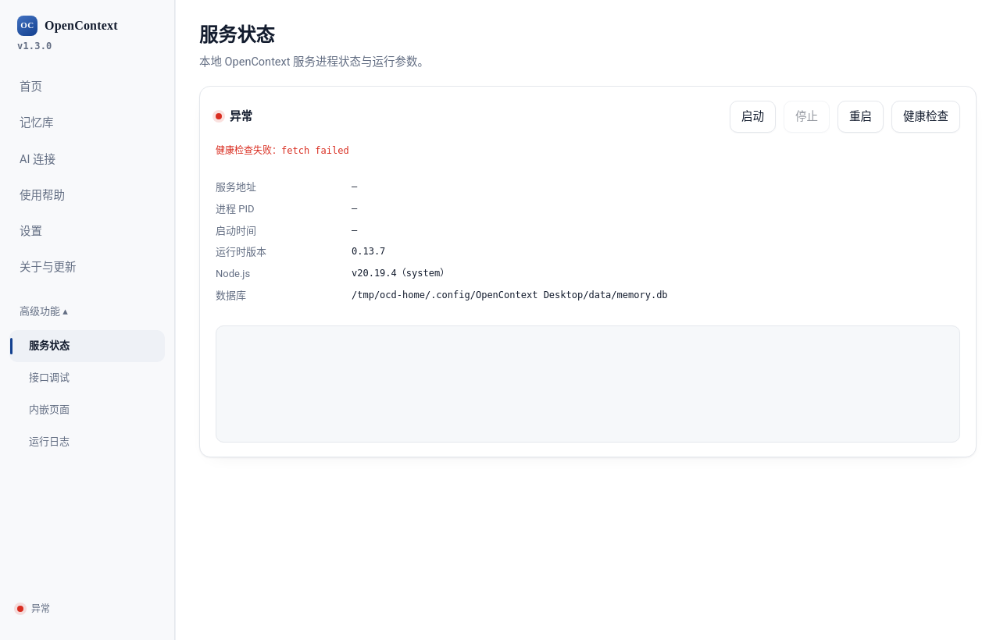

# OpenContext Desktop

[English](README.md) | **简体中文**

OpenContext 桌面版：一键安装、开箱可用的本机记忆库客户端。

这是 OpenContext agentic context runtime（[`@melandlabs/opencontext`](https://www.npmjs.com/package/@melandlabs/opencontext)）的 Electron 桌面外壳。首次启动时它会检测电脑环境、自动安装运行时并启动本地服务。之后可以在内置控制面板里记录、搜索、管理记忆，也可以通过 MCP 或带令牌的 HTTP 接口接给 AI 工具，并支持应用内更新。所有内容只保存在本机。

## 功能

- **首次启动向导**：检测平台（Linux / macOS / Windows，x64 / arm64）、Node.js、npm、npm 源与端口，然后一键安装。本机没有合适的 Node.js（≥ 20）时，会从 `nodejs.org` 下载托管的 Node.js LTS；接着把 `@melandlabs/opencontext` 和 `@melandlabs/ai-rag` 安装到应用数据目录，并做健康检查。
- **本地服务管理**：在 `127.0.0.1` 启动 OpenContext HTTP 服务（默认端口 7421，被占用时自动顺延），支持自动启动、启动 / 停止 / 重启、健康检查、服务与桌面端日志。
- **首页**：记一条（支持 Markdown 预览）、关键词搜索、最近记住的、导出备份。
- **记忆库**：统计、最近 14 天趋势、按标签筛选、排序、翻页，回收站可恢复 / 彻底删除，JSON 导入 / 导出。
- **AI 连接**
  - **MCP**：生成可直接粘贴的 MCP 配置（Claude Desktop、Cursor 等），以 stdio 方式运行 `opencontext mcp`，读写同一个本地数据库。
  - **访问令牌**：主进程内置一个小代理（默认端口 7431），校验 `Authorization: Bearer <令牌>` 后转发到本地服务，令牌在界面中创建和吊销。
- **托盘与全局快捷键**：常驻系统托盘；`Control+Alt+O` 快速记一条，`Control+Alt+P` 查询记忆（可在设置中修改）。
- **搜索方式**：关键词（默认，完全离线）、智能搜索（本地嵌入模型，首次下载约 90MB）、云端模型（需自备 API Key 环境变量）。
- **高级功能**：服务状态、接口调试（`POST /v1/raw-messages`、`POST /v1/search`、`GET /v1/raw-messages/:id`）、内嵌页面、运行日志。
- **自动更新**：基于 `electron-updater` 和 GitHub Releases（检查、下载、重启安装）。

## 截图

以下截图是在 Linux 上用 Xvfb 启动真实的 Electron 应用、由 Playwright 操作后拍下的。首次安装确实完成了运行时的下载和安装，但在本测试环境中，OpenContext 服务（`@melandlabs/opencontext` 0.13.7）启动时以 `SIGSEGV` 崩溃，所以控制面板截图展示的是真实界面在**「服务未运行」**状态下的样子，没有数据。

| 首次启动：环境检测 | 首次启动：安装中 |
| --- | --- |
|  |  |
| **首页（服务未运行）** | **AI 连接：MCP 配置与令牌** |
|  |  |
| **设置** | **服务状态** |
|  |  |

## 技术栈

- Electron 31（渲染层为原生 HTML / CSS / JS，`contextIsolation` + preload 桥接）
- electron-builder 24（AppImage、deb、NSIS、dmg、zip），electron-updater 6
- tar-fs、yauzl：解压托管 Node.js 安装包
- 运行时：`@melandlabs/opencontext` + `@melandlabs/ai-rag`（首次运行时安装，不随包分发）

## 快速开始

开发需要 Node.js 20（CI 使用的版本）。

```bash
git clone https://github.com/gatesenman/opencontext-desktop.git
cd opencontext-desktop
npm ci
npm start            # electron .
```

打包安装包到 `dist/`：

```bash
npm run dist         # 当前平台
npm run dist:linux   # AppImage + deb（x64）
npm run dist:win     # NSIS 安装包（x64）
npm run dist:mac     # dmg + zip（x64、arm64）
```

推送 `v*` 标签会触发 `.github/workflows/release.yml`，在 Ubuntu、Windows、macOS 上构建并发布到 GitHub Releases。

## 项目结构

```
src/
├── main/
│   ├── index.js          # 应用生命周期、窗口、IPC
│   ├── preload.js        # window.opencontext 桥接
│   ├── env-check.js      # 平台 / Node / npm / 源 / 端口检测
│   ├── installer.js      # 下载托管 Node.js + npm 安装运行时 + 健康检查
│   ├── toolchain.js      # 解析托管或系统的 node + npm
│   ├── daemon.js         # 启动并守护 OpenContext HTTP 服务
│   ├── memory.js         # 记录 / 搜索 / 浏览 / 回收站 / 导入导出
│   ├── access.js         # MCP 配置 + 令牌保护的 HTTP 代理
│   ├── quick-capture.js  quick-search.js  tray.js  updater.js
│   ├── config.js  paths.js  logger.js
│   └── scripts/local-store.js   # 离线关键词搜索辅助脚本（从 asar 中解包）
├── renderer/             # setup.html、dashboard.html、quick*.html 及对应 JS、styles.css
└── assets/tray.png
build/                    # icon.png、make-icon.py
electron-builder.yml
```

## 配置

在应用「设置」页修改，保存在 Electron 用户数据目录下的 `config.json` 中（Linux 上例如 `~/.config/OpenContext Desktop`）。同一目录下还有 `node-runtime/`、`server/`、`data/memory.db` 和 `logs/`。

| 配置项 | 默认值 |
| --- | --- |
| 监听地址 / 端口 | `127.0.0.1` / `7421` |
| 令牌代理端口 | `7431` |
| 记忆后端 | `sqlite-vec`（可选 `chroma`、`none`） |
| 嵌入模型 | `none`（关键词搜索） |
| 快速记一条 / 查询记忆快捷键 | `Control+Alt+O` / `Control+Alt+P` |
| npm 源 / Node.js 下载源 | npm 默认 / `https://nodejs.org/dist` |

环境变量：`OPENCONTEXT_NODE_PATH` 可指定优先使用的 Node.js 可执行文件。

## 已知问题

- 如果系统 Node.js 版本较新（例如 Node 24），`better-sqlite3` 没有对应的预编译包，安装运行时会在编译 `better-sqlite3` 时失败；应用会优先使用系统中 ≥ 20 的 Node 而不是下载自带的。临时解决：把 `OPENCONTEXT_NODE_PATH` 指向 Node 20，并把它的 npm 放在 `PATH` 前面。

## 参与贡献

欢迎提 Issue 或 Pull Request。用 `npm start` 测试修改，渲染层无需构建。

## 许可证

[Apache-2.0](LICENSE)
